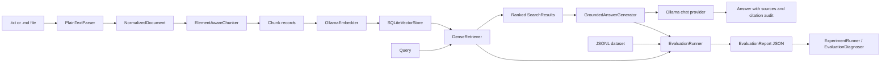

# Architecture

RAG_EVAL is organized as Python modules with explicit contracts between document processing, retrieval, generation, evaluation, and reporting. The currently verified end-to-end path is local: text/Markdown input, Ollama embeddings and chat, and SQLite storage.

## Data flow

Evaluation retrieves once for each query and passes that same result to generation, so retrieval scoring and answer context correspond to the same search output.

## Components and contracts

| Area | Main modules | Behavior |
| --- | --- | --- |
| Parsing and normalization | `core/parsers`, `core/normalize` | Default registry supports UTF-8 `.txt` and `.md`. Parsing produces a normalized document with ordered elements and content digest. |
| Chunking | `core/chunking` | Element-aware chunking preserves links to source elements. Default chunk size/overlap are 1000/200 characters; these are character counts, not tokens. |
| Embeddings | `core/embed` | `OllamaEmbedder` embeds batches and queries using a configured, already available Ollama model. It validates vectors and dimensions. |
| Persistent storage | `core/storage` | `SQLiteVectorStore` stores chunk JSON and vectors. Re-indexing replaces a document atomically and removes stale chunk rows. |
| Retrieval | `core/retrieval` | `DenseRetriever` embeds the query and ranks vectors by exact cosine similarity. Scores range from -1 to 1; higher ranks first. Ties use chunk index, then chunk ID. |
| Generation | `core/llm`, `core/generate` | `OllamaLLMProvider` sends evidence-grounded prompts. `GroundedAnswerGenerator` returns answer text, retrieved sources, resolved citation labels, unresolved labels, and abstains without a model call when retrieval is empty. |
| Dataset and metrics | `eval/datasets`, `eval/metrics` | Validates JSONL ground truth and computes deterministic ranking and lexical answer metrics. |
| Experiments and diagnosis | `eval/runners`, `eval/diagnostics.py` | Compares named variants with paired bootstrap intervals and summarizes evidence-linked failure patterns. |

## Storage and model compatibility

Each SQLite index is bound to one embedding `model_id` and vector dimension. Attempts to index or query with an incompatible model/dimension fail explicitly. To change embedding models, clear the store and re-index all documents. Replacing a document is transactional. Deleting all its chunks leaves the database's model metadata in place; use `clear()` before switching models.

SQLite currently scans all vectors in Python to calculate exact cosine similarity. It is simple and persistent, but search cost grows with the number of indexed chunks. It is not an approximate nearest-neighbor index.

## Evaluation and experiment reports

`EvaluationRunner` writes per-query status, retrieved results, errors, applicable metrics, latency, generated answers, and citation audit. Aggregate metrics include sample counts. The dataset digest hashes exact file bytes (including line endings).

`ExperimentRunner` evaluates runtime components supplied by the caller. Each variant includes JSON-safe descriptive configuration; this metadata is not used to construct the pipeline and must match the actual objects. The report records each evaluation report, its model identities/settings, Python/platform, and paired candidate-minus-baseline metric deltas. Percentile bootstrap intervals are deterministic for fixed data, seed, and resample count. Positive latency delta means slower. Intervals describe variation across the paired query sample, not model/hardware run-to-run uncertainty. Memory/resource tracking is not part of experiment reports.

`EvaluationDiagnoser` groups retrieval errors and recall misses, generation errors, missing answer metrics, low lexical answer overlap, and unresolved citation labels. Findings link to query IDs and recorded evidence. Low token F1 is a configurable triage heuristic, not a correctness test. Citation resolution checks that labels map to retrieved chunks; it does not judge source support.

## Current scope and limitations

- The default ingestion pipeline and CLI support only `.txt` and `.md`; the CLI parses and chunks but does not embed or index.
- Ollama and selected models must be installed and started separately. RAG_EVAL does not download models or load `.env` files automatically.
- The checked-in golden JSONL is empty. There are no project-specific retrieval or answer scores.
- Answer metrics are exact match and token F1. There is no semantic judge or claim-level faithfulness evaluator.
- Retrieval uses dense cosine search. BM25, hybrid, and reranker modules are not wired into this verified workflow.
- `apps/api` serves an invite-only hosted beta API and built React application. `apps/worker` handles embedding, evaluation, and experiment jobs through RQ. See [the hosted beta guide](hosted-beta.md) for deployment limits.
- PDF, DOCX, and image parser modules are not registered in the default ingestion pipeline.

## Hosted beta path

The hosted application adds GitHub identity sign-in, invited-email checks, secure session cookies, private account workspaces, workspace-scoped PostgreSQL policies, Redis/RQ indexing and evaluation, private S3-compatible originals, and a same-origin React workbench. Hosted text is segmented into stable source elements; Ollama vectors are stored with those elements and exact cosine search ranks them. Ask uses one retrieved evidence list for the answer prompt and citation audit. Gemini and Groq keys are encrypted at rest and can be selected for chat only; Ollama remains responsible for embeddings.

Evaluation datasets are stored as immutable canonical JSON revisions with SHA-256 digests. Source-element references are checked against the active workspace. Retrieval reports retain per-query excerpts, metric values, and counts. Retrieval-depth experiments pair the same query IDs and record configured variants and bootstrap intervals.

The hosted app is beta code. Containers use Alembic migrations; the migration has been checked on SQLite but still needs validation against the target PostgreSQL service. Its worker stores exact source-element vectors as serialized text for Python cosine scans instead of chunked pgvector indexing. Rate limiting, automated 30-day backup expiry, self-service export, and comprehensive operational alerts require deployment work. These limits are detailed in [docs/hosted-beta.md](hosted-beta.md).
